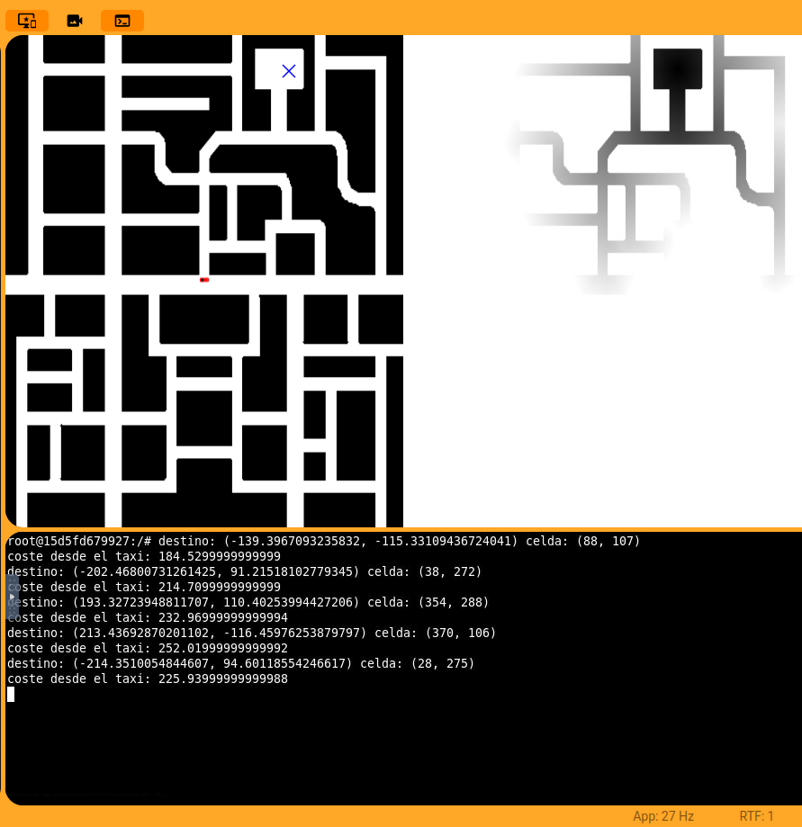

## Objetivo
El objetivo de esta práctica es programar un coche autónomo que haga de taxi en una ciudad. El coche conoce su posición gracias a un GPS y dispone de un mapa de la ciudad. Cuando el usuario marca un destino haciendo clic sobre el mapa, el taxi debe **planificar** cómo llegar desde donde está y después conducir hasta allí sin chocar con los edificios.

La planificación se hace con el algoritmo **Gradient Path Planning (GPP)**, y la conducción con un bucle reactivo que fija la velocidad lineal $ V $ y la velocidad angular $ W $. Al llegar, el taxi espera a que el usuario marque un nuevo destino.

## Implementación

### Exploración del mapa
El mapa es una matriz de $ 400 \times 400 $ (cada celda mide $ 1{,}25 $ m) con dos valores:

| Valor | Significado |
|:-----:|:------------|
| 255 | Calle |
| 0 | Edificio |

Lo comprobé mirando la celda del taxi, que empieza en una calle.

Al pasar un punto del mundo a celda se obtienen dos números $ (a, b) $, pero el mapa hay que leerlo **al revés**, como `mapa[b][a]`. Lo comprobé haciendo clic en varias calles, solo en ese orden salía siempre 255. Para no tener que recordarlo, lo metí en una función.

### Propagación del campo
El campo es otra matriz de $ 400 \times 400 $ en la que cada celda guarda el **coste de llegar desde ella al destino**.

1. Todas las celdas empiezan en **infinito** ("aún no sé cuánto cuesta") y el destino en **0**.
2. Una **cola de prioridad** guarda las celdas pendientes y siempre devuelve la más barata, así la onda avanza en orden.
3. Se saca una celda y se miran sus 8 vecinas. Si la vecina es calle y llegar por aquí cuesta menos de lo que tenía, se actualiza y se mete en la cola.

| Celda vecina | Coste del paso |
|:-------|:--------------:|
| Recta | 1 |
| Diagonal | 1,41 ($ \sqrt{2} $) |

No hace falta calcular toda la ciudad. La onda **se para** cuando supera el coste del taxi en un margen de 20 celdas, para que el coche tenga valores a su alrededor.

_El destino es lo más oscuro y las calles se aclaran al alejarse. En blanco, los edificios y lo que no se ha calculado_

### Penalización de obstáculos
Para penalizar por **cercanía** a los edificios, primero hay que medir lo cerca que está cada celda del edificio más próximo. Para eso se "engordan" los edificios **capa a capa**. La capa 1 son las calles que tocan un edificio, la capa 2 las que tocan la capa 1, y así hasta 5 capas. Es como otra onda, pero que sale de todos los edificios a la vez. 

**Cada capa suma una penalización que baja al alejarse del edificio**.
 
> Como los edificios no se mueven, la penalización **no depende del destino**, se calcula una sola vez al arrancar, y en cada clic solo se recalcula la onda.

El campo final es la suma **$ F = D + P $**.

### Conducción